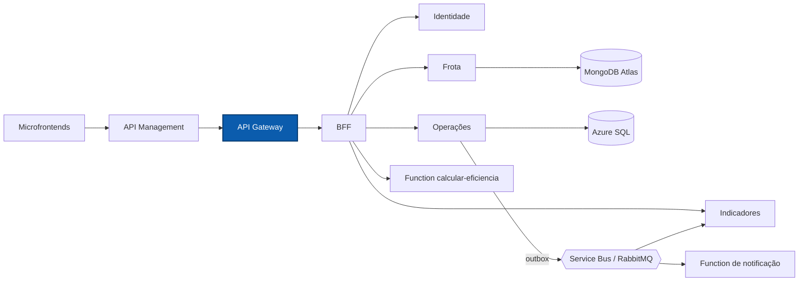

# NexFleet Gateway

Porta de entrada única do back-end do NexFleet: roteia as chamadas da aplicação web para o BFF e publica a documentação interativa de todas as APIs.

[](https://github.com/mateusblm/nexfleet-gateway/actions/workflows/ci.yml)
[](https://hub.docker.com/r/mateusblm/nexfleet-gateway)


---

## Visão geral

O NexFleet é uma plataforma de gestão de frotas empresariais: veículos, motoristas, vínculos, abastecimentos, manutenções, painel de custos e uma visão consolidada de eficiência.

O **Gateway** fica entre o Azure API Management e o BFF. Na nuvem, o APIM encaminha todo o tráfego para ele; no ambiente local, ele é a porta publicada (`127.0.0.1:8080`). O Gateway não tem regra de negócio: aplica a lista de rotas permitidas, propaga o identificador de correlação e serve a **Swagger UI única** do produto.



## Funcionalidades

- Roteamento explícito, por caminho **e** método HTTP, de cada rota pública `/api/v1/...` para o BFF; rotas fora da lista (como as APIs internas `/api/v1/frota/...`) não são expostas.
- Cabeçalho `Authorization` e corpo preservados até o BFF, que valida o JWT.
- `GET /aggregated-data` e `GET /api/v1/aggregated-data` encaminhados ao BFF.
- Swagger UI única em `/swagger-ui.html`, com seletor entre BFF, Frota, Operações, Identidade e Indicadores; cada OpenAPI é lido de `/docs/<serviço>/v3/api-docs`.
- Geração ou propagação do cabeçalho `X-Correlation-ID` em todas as requisições.
- Health checks (liveness/readiness) e métricas Prometheus via Actuator.
- Tempo limite de conexão de 2 s e de resposta de 25 s para os serviços de destino.

## Arquitetura

O Gateway é um componente de borda sem casos de uso, por isso não tem fatias verticais nem camadas de domínio. O código fica em `br.com.nexfleet.gateway`:

| Pacote | Responsabilidade |
|---|---|
| `config` | Tabela de rotas (`GatewayConfig`) para o BFF e para os OpenAPI dos serviços; regras de segurança |
| `observability` | Filtro WebFlux que gera ou propaga o `X-Correlation-ID` |

Os serviços de negócio seguem Clean Architecture + Vertical Slice. Aqui, o ArchUnit garante que o Gateway **não importa código interno** de nenhum outro serviço (`identidade`, `frota`, `operacoes`, `indicadores`, `bff`).

## API

Todas as rotas `/api/v1/...` e `/aggregated-data` são encaminhadas ao BFF, que exige `Authorization: Bearer <token>` (exceto login e ambiente).

| Método | Rota | Descrição |
|---|---|---|
| `POST` | `/api/v1/auth/login` | Login e emissão do JWT |
| `GET` | `/api/v1/auth/me` | Usuário autenticado |
| `GET` | `/api/v1/ambiente` | Situação do ambiente (pública) |
| `GET`, `POST` | `/api/v1/usuarios` | Listar e criar usuários |
| `GET`, `PUT`, `DELETE` | `/api/v1/usuarios/{id}` | Consultar, editar e inativar usuário |
| `GET`, `POST` | `/api/v1/veiculos` | Listar e cadastrar veículos |
| `GET`, `PUT`, `DELETE` | `/api/v1/veiculos/{id}` | Consultar, editar e inativar veículo |
| `GET`, `POST` | `/api/v1/motoristas` | Listar e cadastrar motoristas |
| `GET`, `PUT` | `/api/v1/motoristas/{id}` | Consultar e editar motorista |
| `DELETE` | `/api/v1/{veiculos,motoristas,usuarios}/{id}/definitivo` | Exclusão definitiva |
| `GET`, `POST` | `/api/v1/vinculos` | Listar e criar vínculos motorista ↔ veículo |
| `PUT` | `/api/v1/vinculos/{id}/encerramento` | Encerrar vínculo |
| `GET`, `POST` | `/api/v1/abastecimentos` | Listar e registrar abastecimentos |
| `GET`, `POST` | `/api/v1/manutencoes` | Listar e registrar manutenções |
| `GET` | `/api/v1/dashboard` | Painel de custos e situação da frota |
| `GET` | `/aggregated-data`, `/api/v1/aggregated-data` | Visão consolidada (Frota + Operações + eficiência) |
| `GET` | `/swagger-ui.html` | Swagger UI única (pública) |
| `GET` | `/docs/{bff,frota,operacoes,identidade,indicadores}/v3/api-docs` | OpenAPI de cada serviço (público) |
| `GET` | `/actuator/health`, `/actuator/prometheus` | Saúde e métricas |

Documentação interativa em produção: **[Swagger UI](https://apim-nexfleet-homolog-ukzjodf42myfe.azure-api.net/swagger-ui.html)**.

## Stack

| Camada | Tecnologia | Versão |
|---|---|---|
| Linguagem | Java | 21 |
| Framework | Spring Boot | 4.1.1 |
| Roteamento | Spring Cloud Gateway Server WebFlux (Spring Cloud) | 2025.1.2 |
| Segurança | Spring Security | gerenciada pelo Spring Boot |
| Documentação | springdoc-openapi (Swagger UI WebFlux) | 3.2.0 |
| Observabilidade | Spring Boot Actuator, Micrometer + Prometheus | gerenciadas pelo Spring Boot |
| Testes | JUnit 5, ArchUnit | 5 / 1.4.1 |
| Build | Maven Wrapper | 3.9.16 |
| Contêiner | `eclipse-temurin:21-jre-jammy` | 21 |
| CI/CD | GitHub Actions → Docker Hub | — |

## Primeiros passos

### Pré-requisitos

- JDK 21 (o Maven vem pelo wrapper `./mvnw`)
- Docker, para gerar e executar a imagem

### Testes

```bash
./mvnw -B -ntp verify
```

### Executar com Docker

```bash
docker run --rm -p 8080:8080 \
  -e BFF_URL=http://<host-do-bff>:8080 \
  -e IDENTIDADE_URL=http://<host-da-identidade>:8080 \
  -e FROTA_URL=http://<host-da-frota>:8080 \
  -e OPERACOES_URL=http://<host-de-operacoes>:8080 \
  -e INDICADORES_URL=http://<host-de-indicadores>:8080 \
  mateusblm/nexfleet-gateway:v1.0.0
```

Para gerar a imagem a partir do código: `docker build -t mateusblm/nexfleet-gateway:local .`

### Ambiente completo

O produto inteiro (todos os serviços, SQL Server, MongoDB e RabbitMQ) sobe pelo repositório [nexfleet](https://github.com/mateusblm/nexfleet):

```bash
git clone https://github.com/mateusblm/nexfleet.git && cd nexfleet
scripts/clonar-tudo.sh                                        # clona os demais repositórios ao lado
scripts/iniciar-local.sh                                      # gera o .env e a chave RSA local
docker compose -f compose.yaml -f compose.build.yaml up -d --build
scripts/seed-demo.sh                                          # dados de demonstração
```

O Gateway fica em `http://127.0.0.1:8080` e a Swagger UI em `http://127.0.0.1:8080/swagger-ui.html`.

## Configuração

| Variável | Descrição | Padrão |
|---|---|---|
| `PORT` | Porta HTTP | `8080` |
| `BFF_URL` | URL do BFF | `http://localhost:8090` |
| `IDENTIDADE_URL` | URL da Identidade (OpenAPI) | `http://localhost:8081` |
| `FROTA_URL` | URL de Frota (OpenAPI) | `http://localhost:8082` |
| `OPERACOES_URL` | URL de Operações (OpenAPI) | `http://localhost:8083` |
| `INDICADORES_URL` | URL de Indicadores (OpenAPI) | `http://localhost:8084` |

## Ambiente em nuvem

| Recurso | Endereço |
|---|---|
| Aplicação | https://white-mushroom-0cadda010.3.azurestaticapps.net |
| API (Azure API Management) | https://apim-nexfleet-homolog-ukzjodf42myfe.azure-api.net |
| Swagger UI | https://apim-nexfleet-homolog-ukzjodf42myfe.azure-api.net/swagger-ui.html |
| AsyncAPI dos eventos | https://white-mushroom-0cadda010.3.azurestaticapps.net/docs/eventos/ |
| Imagem Docker | https://hub.docker.com/r/mateusblm/nexfleet-gateway |

O Gateway roda em Azure Container Apps e não tem URL pública própria: é alcançado pelo API Management.

> Os serviços escalam a zero quando ociosos. A primeira requisição após um período de inatividade pode levar de 1 a 2 minutos.

## Testes

| Tipo | Classes | O que cobre |
|---|---|---|
| HTTP | `GatewayHttpTest` | Rotas e métodos encaminhados ao BFF, preservação de token e corpo, `X-Correlation-ID`, bloqueio das APIs internas |
| HTTP | `SwaggerUiHttpTest` | Swagger UI e seletor de OpenAPI dos serviços |
| Arquitetura (ArchUnit) | `ArchitectureTest` | Nenhuma dependência de código interno de outros serviços |

```bash
./mvnw -B -ntp verify
```

O CI (`.github/workflows/ci.yml`) executa `verify` a cada push e pull request; em tags `v*`, publica `mateusblm/nexfleet-gateway:<tag>` e `:latest` no Docker Hub.

## Equipe

- Vinícius dos Reis Góes
- Mateus Burlamaqui
- Lucas Roussenq
- Erik Carvalho
